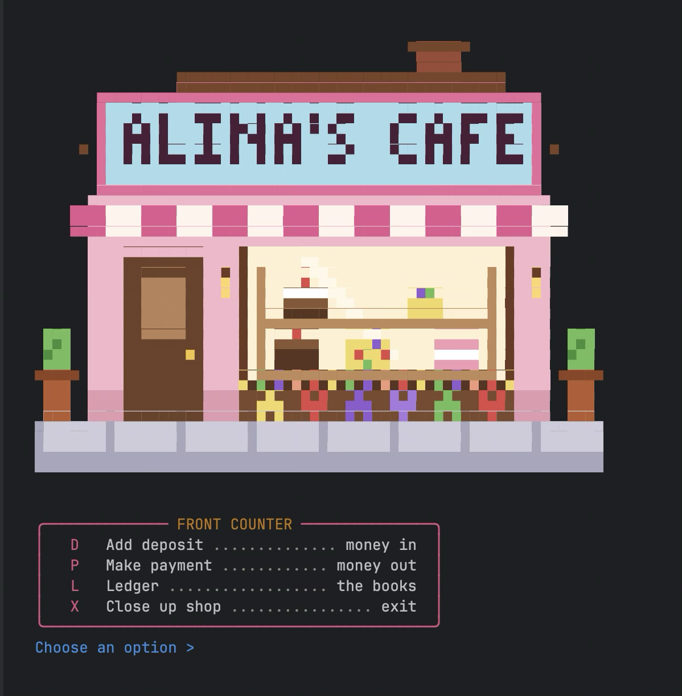
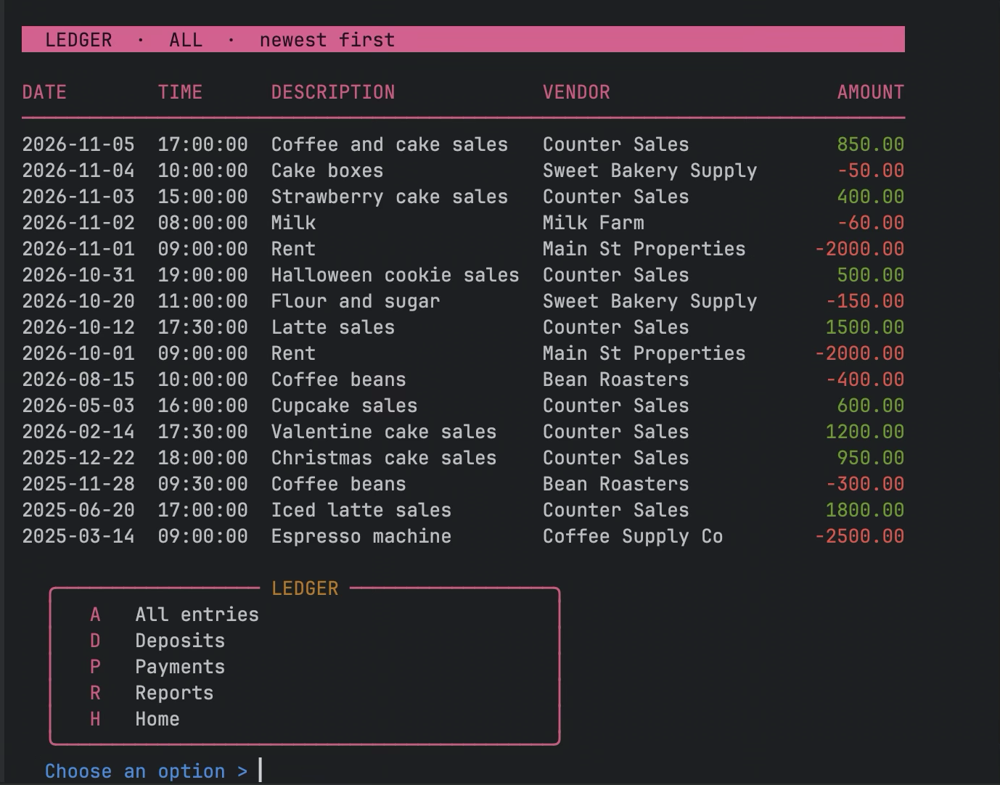
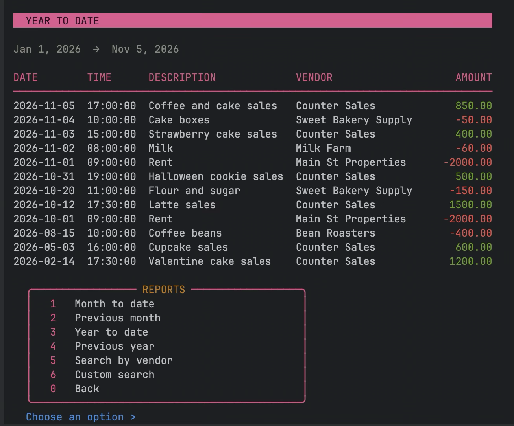

# ☕ Alina's Cafe: Accounting Ledger

A Java command-line app that tracks a small cafe's money: every deposit coming in and every payment going out. Transactions are saved to a CSV file, so the history is still there the next time the app opens.

It's dressed up as a cafe, with a pixel-art storefront, a soft welcome sound, pink menu boards and printed receipts.

Built as Capstone 1 for the Year Up United Software pathway.

---

## Screenshots

| Storefront + home | Ledger | Report |
|---|---|---|
|  |  |  |

---

## Features

### Home screen (Front Counter)
- **D) Add deposit**: money in, always saved as positive
- **P) Make payment**: money out, always saved as negative (even if you type a positive number)
- **L) Ledger**: view transactions
- **X) Close up shop**: exit

After every deposit or payment the app plays a short sound and prints a receipt.

### Ledger screen
All lists show the **newest entries first**, with deposits in green and payments in red.
- **A) All entries**
- **D) Deposits** only
- **P) Payments** only
- **R) Reports**
- **H) Home**

### Reports screen
- **1) Month to date**
- **2) Previous month**: works across years (January → December)
- **3) Year to date**
- **4) Previous year**
- **5) Search by vendor**: case-insensitive
- **6) Custom search** (bonus): filter by any mix of start date, end date, description, vendor and amount. Leave a filter blank to skip it.
- **0) Back**

Every report shows a friendly message when nothing matches.

### Input checks
- Description and vendor can't be blank.
- The amount must be a number and can't be 0.
- A `|` typed by the user is swapped for `-`, so it can't break the CSV.
- A badly typed date or amount in custom search shows a message instead of crashing.

---

## How to run

**Requirements:** Java 17 and Maven

### IntelliJ
1. Clone the repo and open the folder in IntelliJ
2. Open `src/main/java/com/pluralsight/LedgerApp.java`
3. Click ▶️ next to `main`

> 💡 For the storefront picture to look right, set the console line height to **1.0**
> (Settings → Editor → Color Scheme → Console Font).

### Terminal
From the project root (the folder with `pom.xml` and `transactions.csv`):

```bash
mvn compile
java -cp target/classes com.pluralsight.LedgerApp
```

> ⚠️ Always run from the project root. The app looks for `transactions.csv` and `cafe_storefront.txt` in the folder it's started from.

---

## Data file

Transactions are stored in `transactions.csv`, one per line:

```
date|time|description|vendor|amount
2026-11-02|08:05:00|Coffee beans 20lb|Bean Roasters|-320.00
2026-11-03|14:30:05|Latte sales|Counter Sales|185.50
```

- Positive amount = deposit, negative amount = payment
- New transactions are **appended** to the end, so history is never overwritten

---

## Project structure

```
src/main/java/com/pluralsight/
├── LedgerApp.java        → starting point: shared Scanner + transaction list, opens home
├── Transaction.java      → one transaction (date, time, description, vendor, amount)
├── FileManager.java      → loads the CSV at startup, saves each new transaction
├── screens/
│   ├── HomeScreen.java   → deposit, payment, input checks
│   ├── LedgerScreen.java → all / deposits / payments
│   └── ReportsScreen.java→ date reports, vendor search, custom search
└── theme/
    ├── CafeTheme.java    → colors, menu boards, table header, receipt, storefront
    └── CafeSound.java    → welcome, deposit and payment sounds (Java's built-in MIDI)

cafe_storefront.txt       → the pixel-art storefront, one letter per pixel
transactions.csv          → the data
```

Each class has one job: the screens talk to the user, `CafeTheme` decides how things look, and `FileManager` is the only class that touches the file.

---

## Code highlight: one helper for four date reports

All four date reports work the same way: each one only picks a **start** and an **end** date, then hands them to one shared method, `showDateRange(start, end)`, which does the looping and printing.

| Report | Start | End |
|---|---|---|
| Month to date | 1st of this month | today |
| Previous month | 1st of last month | last day of last month |
| Year to date | Jan 1 of this year | today |
| Previous year | Jan 1 of last year | Dec 31 of last year |

### Previous month: the anchor trick

```java
public static void previousMonth() {
    LocalDate firstOfThisMonth = LocalDate.now().withDayOfMonth(1);  // the anchor
    LocalDate start = firstOfThisMonth.minusMonths(1);               // one month back
    LocalDate end = firstOfThisMonth.minusDays(1);                   // one day back
    showDateRange(start, end);
}
```

Both dates are worked out from the **anchor**, the 1st of this month. Going back one day from the 1st always lands on the last day of the month before, so there's no need to know whether a month has 28, 30 or 31 days.

| Today | Anchor | Start (−1 month) | End (−1 day) |
|---|---|---|---|
| Nov 6, 2026 | Nov 1, 2026 | Oct 1, 2026 | Oct 31, 2026 |
| Mar 10, 2027 | Mar 1, 2027 | Feb 1, 2027 | **Feb 28, 2027** |
| Jan 15, 2027 | Jan 1, 2027 | **Dec 1, 2026** | **Dec 31, 2026** |

In January, `LocalDate` rolls the month **and the year** back by itself.
A simple `month - 1` would give month 0 and keep the wrong year.

### Showing the range: both edge days count

```java
if (!date.isBefore(start) && !date.isAfter(end)) {
    System.out.println(transaction);
}
```

"Not before the start **and** not after the end", so the first and last day are both included.

Example: start = Oct 1, end = Oct 31

| Transaction date | Shown? |
|---|---|
| Sep 30 | ❌ too early |
| Oct 1 | ✅ start day |
| Oct 15 | ✅ |
| Oct 31 | ✅ end day |
| Nov 1 | ❌ too late |